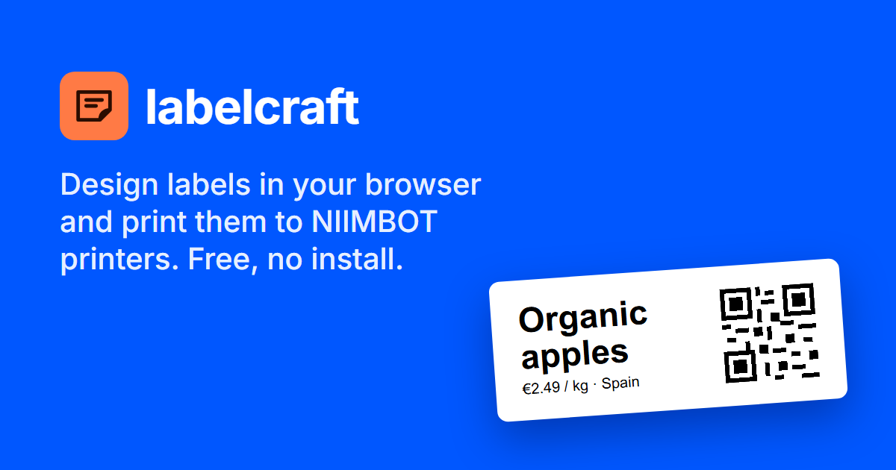

# labelcraft — free label designer for NIIMBOT printers, in your browser

**labelcraft** is a free, open-source label maker that runs in your web
browser. Design labels with text, QR codes, barcodes, images, shapes and
frames, then print them to a NIIMBOT thermal label printer (D11, D110, B1,
B21 and more) over **Bluetooth** or a **USB cable**. No install, no account,
nothing to download.

**[Open labelcraft → anthonyda.github.io/labelcraft](https://anthonyda.github.io/labelcraft/)**

[](https://anthonyda.github.io/labelcraft/)

> **Not affiliated with NIIMBOT.** This is an independent project. It is not
> made, endorsed or supported by NIIMBOT. Printer communication uses the
> open-source [niimbluelib](https://github.com/MultiMote/niimbluelib) library.

## Features

- **Free placement:** text, rectangles, ellipses, lines, QR codes, barcodes
  (Code 128 and EAN-13) and images, anywhere on the label. Move, resize,
  rotate, align, duplicate, undo and redo.
- **Official NIIMBOT label sizes** for each printer family, plus custom sizes.
  Landscape or portrait.
- **Reads the loaded roll** when the printer reports it, and offers its size.
- **67 label frames** in six categories, from simple lines and rounded corners
  to stamps, hearts, cats, paws and flowers.
- **Images to black and white** with a threshold slider, ready for a thermal
  printer.
- **What you see is what prints:** the print preview is the exact bitmap sent
  to the printer, dot for dot. Anything past the label edge is outlined in red.
- **Real-size zoom** (10–2000%), with screen calibration against a real label.
- **Layers panel** with drag and drop and renaming, and magnet snapping to
  edges and centres.
- **Save and open** labels in the browser, export them as JSON files or PNG
  images, and import them again.
- **Desktop and Android phones**, light and dark themes.

## Supported printers

labelcraft talks to printers through
[niimbluelib](https://github.com/MultiMote/niimbluelib), so it works with the
models that library supports. Label sizes are listed for these families:

| Family   | Models                                                        |
| -------- | ------------------------------------------------------------- |
| D series | D11, D11S, D11_H, D11 Pro, D110, D110_M, H1, H1S              |
| D101     | D101                                                          |
| N1 / B18 | N1, B18, B18S, B16                                            |
| B series | B1, B1 Pro, B1 SE, B2, B2 Pro, B21, B3S, B31, B203, B50, B50W |
| B4       | B4, B4 Pro                                                    |
| K series | K2, K3, K3_ITD, K3_W, K4                                      |
| M series | M2_H, M3                                                      |

The model is detected when you connect, or you can pick it yourself.

## How to print a label

1. Open [labelcraft](https://anthonyda.github.io/labelcraft/) in Chrome, Edge
   or Opera.
2. Pick your label size, then add text, a QR code, a barcode or an image.
3. Click **Connect**, choose Bluetooth or USB, and select your printer.
4. Click **Print…**, check the preview, set the number of copies and print.

## Browser support

Printing needs **Web Bluetooth** or **Web Serial**: Chrome, Edge or Opera on
Windows, macOS, Linux or ChromeOS, or Chrome on Android. Firefox and Safari
can open the editor and design labels, but cannot print.

## FAQ

**Is it free?** Yes. labelcraft is free and open source under the MIT license.

**Do I need the NIIMBOT app or an account?** No. labelcraft connects to the
printer directly from the browser.

**Where are my labels stored?** In your browser only (local storage). Nothing
is sent to a server; the site is static files on GitHub Pages.

**Why can't I print from Firefox or Safari?** They don't support Web Bluetooth
or Web Serial, which a web page needs to talk to the printer.

## Development

Built with React, TypeScript, Vite and Konva.

```sh
npm install
npm run dev        # dev server
npm run lint       # oxlint + prettier check
npm test           # unit tests (Vitest)
npm run test:e2e   # browser tests (Playwright, Chromium)
npm run build      # production build in dist/
```

Pushes to `main` are linted, tested, built and deployed to GitHub Pages.

## License

[MIT](LICENSE)
